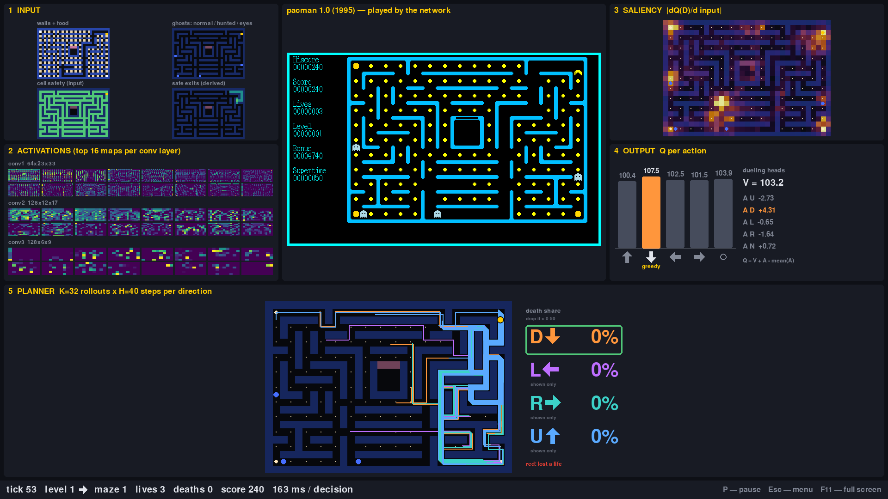
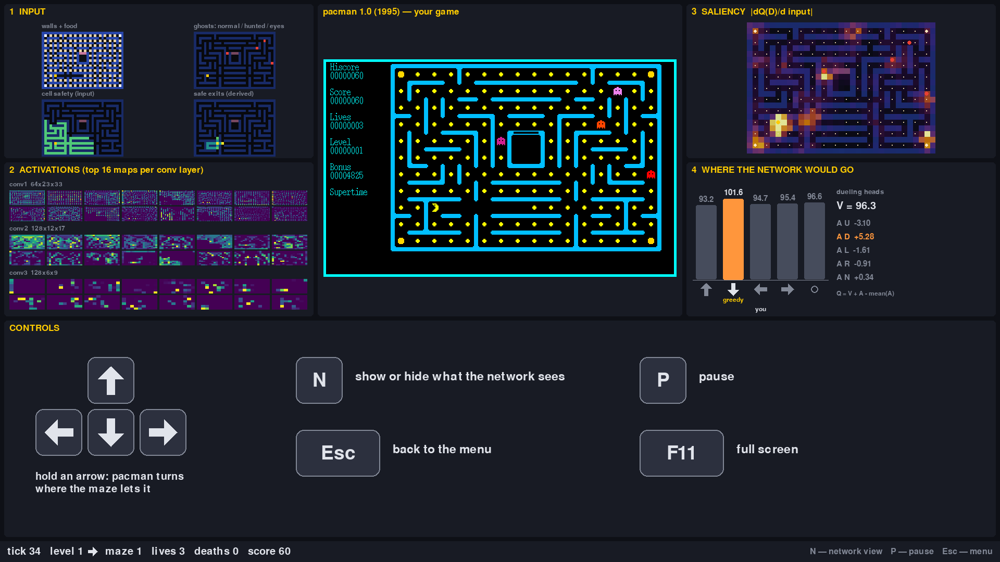
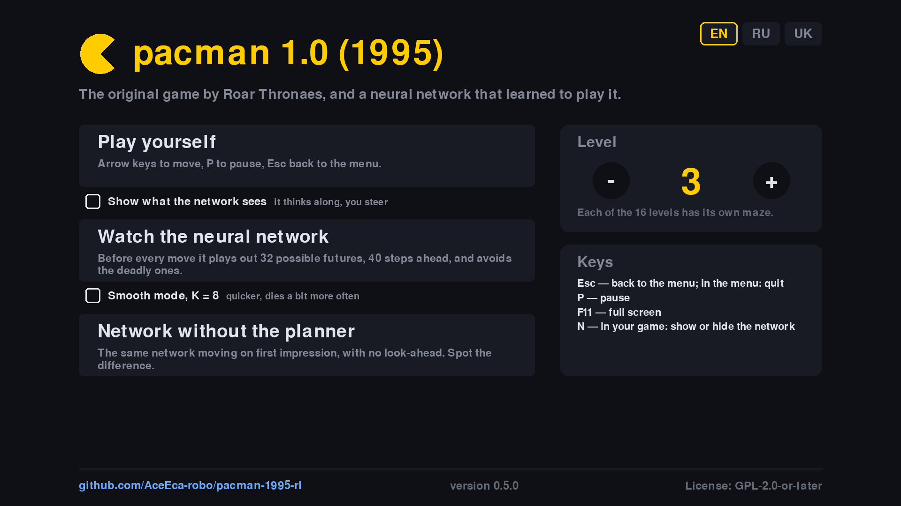

# pacman-1995-rl

Reinforcement learning on the **original pacman 1.0** (1995, Roar Thronaes,
GPL-2+), the X11 game from the Debian package `pacman` (version 10-21). The
game is not reimplemented: its C++ sources are compiled with a small bridge
and driven as a gymnasium environment through a Unix socket.

A network trained from demonstrations (best_v04) plays all 16 mazes of the
game; before every move a rollout planner tries the four directions in a
byte-exact copy of the game, with the same network playing the rollouts.
Together they clear **all 16 mazes in 320 of 320 games, 0.23 deaths per
game**. The network alone clears 81.8% of the games per maze (the
heuristic it learned from: 78.2%); the planner without the network
clears none. A desktop app shows the network thinking, or lets you play
while it watches.



> v0.5 (2026-10-21): the app in one window; the planner H40/K32 as its
> default. Numbers are taken from `docs/results.md` and the session logs
> `docs/overnight.md`.

## Install

On Ubuntu / Debian with an X11 desktop (GNOME, also XWayland):

```bash
git clone https://github.com/AceEca-robo/pacman-1995-rl.git && cd pacman-1995-rl
./install.sh        # or ./install.sh --cpu: torch without CUDA, a much smaller download
```

`install.sh` lists the missing system packages with the `sudo apt install`
line for them, builds the game, creates `.venv` and puts
"Pacman 1995 RL" into the applications menu (plus `~/.local/bin/pacman-rl`).
On its first start the app offers to download the network's weights
(`best_v04.pt`, 118 MB,
[v0.5 release](https://github.com/AceEca-robo/pacman-1995-rl/releases/tag/v0.5))
into `~/.local/share/pacman-rl/` and checks their SHA-256. `./uninstall.sh`
removes the menu entry (`--purge`: also the weights and the settings).

The app is one 1920x1080 window (F11: full screen) in English, Russian or
Ukrainian (the switch in the corner of the menu and of the pause menu),
with three modes:

- **Watch the neural network**: the network with the planner. Around the
  real game: what the network sees (its input planes), its convolutions,
  saliency, Q values, and the planner's rollouts (red: lost a life).
  Smooth mode uses 8 rollouts per direction instead of 32 (on a CPU the
  32 play in slow motion).
- **Network without the planner**: the network alone, greedy.
- **Play yourself**: the original game in the centre, your arrow keys
  forwarded to it (XTest, about 1-2 ms); N shows what the network sees in
  your game and where it would go, without steering. The game polls the
  keyboard once per tick (0.25 s), as the original does: a tap shorter
  than a tick that falls between two polls never reaches it. The app
  therefore latches the arrows: a pressed arrow stays down on the game's
  display until the game has polled after the press or another arrow is
  pressed (in a test 50 of 50 taps of 30 ms reached the game, 4-11 of 50
  without the latch).

Any of the 16 levels; P pauses (continue / back to the menu / quit), Esc goes
back to the menu, Esc in the menu quits. Each game runs on a private Xvfb
and is grabbed into the window. `scripts/play.py` does the same from a
terminal (and records mp4).

| your game, with the network's view (N) | the menu |
|---|---|
|  |  |

More: `docs/app_*.png` (every screen, also in Russian and Ukrainian).

## Results

| agent | games per maze | mazes cleared (mean of 16) | worst maze | deaths per game |
|---|---|---|---|---|
| heuristic (BFS, `agents/heuristic_agent.py`) | 100 | 78.2% | 58% | — |
| BC: a network copying the heuristic (bc0_dagger3) | 100 | 68.4% | 45% | — |
| best_v03: DQfD from the BC | 100 | 75.2% | 52% | — |
| **best_v04**: + the cell-safety plane, greedy | 100 | **81.8%** | **67%** | 1.45 |
| planner without the network (random rollouts) | 10 | 0% | 0% | 3.0 |
| **best_v04 + planner H40/K32** | 20 | **100%** | **100%** | **0.23** |

"Mazes cleared": the share of games started on a maze that clear it; the
first four rows on the final protocol (100 games per maze, seeds
2000..3599, 95% intervals in `docs/results.md`, "Final results v0.4"), the
planner rows in the sim on seeds 0..19 / 0..9 (`scripts/plan_eval.py`;
replayed games match the real game). best_v04's deaths per game: 50 games
per maze, seeds 5000.. (`scripts/death_report.py`). Levels in a row from
level 1: best_v04 1.48 (max 6), with the planner (H40/K8) 7.7 (max 14).

## The path

| | stage | result | what made it |
|---|---|---|---|
| 1 | random actions | 92 points, level 1 never cleared | — |
| 2 | dqn0: DQN from scratch, 5M steps | 128 of 172 food, 0% | event reward (dots, death) |
| 3 | dqn1: 20M steps | 151 of 172 food, 0% | more steps: a plateau |
| 4 | dqn8 | level 1 cleared in 67% | episodes starting near the end of the level + dots worth more as the board empties |
| 5 | dqn10 | level 1: 85% | its own endgame openings, prioritized replay |
| 6 | mm1: all 16 mazes from scratch | ~136 of 172 food on every maze, 0% | — (the plateau again) |
| 7 | BC of the heuristic | 98.8% agreement, 68.4% per maze | behaviour cloning + DAgger |
| 8 | best_v03 (DQfD) | 75.2% per maze | RL from the clone, demonstrations in the batch, released gradually |
| 9 | best_v04 | 81.8% per maze, above the heuristic | a cell-safety plane: cells pacman reaches before any ghost |
| 10 | sim/ + planner (honest, K = 8) | 99.1% per maze, 7.7 levels in a row | a byte-exact port of the game to roll out the future |
| 11 | planner H40/K32 | 100% per maze, 320 of 320 games | more rollouts, not a longer horizon |

Watching the games on screen gave both turns of the network part: "stands
at a wall" (a fixed point of the greedy policy: when nothing moves, the
same action is chosen again) led to the endgame curriculum, "squeezed in
a corridor" led to the cell-safety plane. The plane is what best_v04 is
built on: fed as zeros, it clears 0% (results.md, "Plane ablation"); the
ablation from best_v03 credits it with most of the gain (+3.0 points
against +0.8 for the longer horizon).

What did not move the network past best_v04 (`docs/results.md`): training
on its own deaths (dqfd3, 80.8%), escape demonstrations from 80-120 ticks
before a death (dqfd4, 80.4%), training longer (dqfd2 to 290M steps:
75.0%). Squeezes stay 83-85% of its deaths. From the state 40 ticks before
a death, 52% of the deaths have no surviving continuation in 80 noisy
rollouts: the trap closes about 100 ticks ahead, and a network that sees
one frame does not look that far. Earlier dead ends: a heuristic warm
start, distance shaping, a hunger limit, PPO, a food-distance plane.

## How the planner works

`sim/` is a clonable port of the game (`docs/sim_spec.md`): `PacmanSim`
(Python) and `CSim`/`SimBatch` (C via ctypes, with the env observation),
incl. an exact copy of glibc `random()`. Given the same seed and actions
they produce the game's JSON state lines byte for byte
(`scripts/verify_sim.py`: 0 differences in 610k Python and 600k C steps).

Before every move `scripts/plan_eval.py`'s planner rolls out the network's
best direction K times for H steps in clones of the sim (the network plays
the rollouts, with 10% random moves); if more than half of the rollouts
lose a life, the other directions are rolled out too and the best one by
Q that does not is played. "Honest": every clone gets new ghost randomness,
so the rollouts sample futures instead of reading the real one (cloning the
game's random state — the "oracle" — gives 22.4 levels in a row; not used).
A loop breaker steers pacman away from cells it keeps revisiting without
eating. The default, `configs/plan_honest_lb.yaml`: H = 40, K = 32, 20
decisions/s on one GPU (p95 53 ms; a tick is 0.25 s).

## How the game became an environment

- `game/` holds the unmodified sources (first commit) plus minimal patches,
  each marked `// RL bridge`. Windows (`MSWIN`) branches are untouched.
  Changes to the original files: 79 added and 5 removed lines in 9 files
  (most of them argument parsing in `arg.cc`), plus the new
  `game/rlbridge.cc/.h` (157 lines).
- `--rl <socket>`: the game connects to a Unix socket, sends one JSON state
  per tick (board 23 x 33, pacman, ghosts, bonus, score, lives, level,
  supertime) and blocks for one action line (`U/D/L/R/N`).
- `--fast`: no sleeping between ticks. `--headless` (with `--rl`): no X11 at
  all; a test checks that the state stream is byte-identical to the X11 mode.
  `--seed N`: deterministic games. `--no-ghosts`: ghosts stay in their house
  (diagnostics only). `--level N`: start on level N (also without `--rl`).
  `--rl-watch` (with `--rl`): the states are sent, but pacman is steered from
  the keyboard (the app's "play yourself" with the network watching).
- Throughput: a single headless env runs at about 32k steps/s with random
  actions (`scripts/bench_env.py`, `docs/results.md`).
- `env/pacman_env.py`: `Pacman1995-v0`, a gymnasium env that starts the game
  (headless by default, or in a window with `display=":0"`) and serves the
  socket.

## Observation and reward

The observation is a `Dict`: 21 binary/count planes over the 23 x 33 board
(walls, gate, dots, energizers, pacman and its direction, last requested
direction, ghosts by state and direction, bonus) and a small vector (lives,
supertime, level); optional extra planes: food distance, **cell safety**
(1 on every cell pacman reaches strictly before every normal ghost; all of
its reachable cells while it is super; best_v04 has it) and safe exits.
Details: [docs/observation.md](docs/observation.md).

The reward counts events, not the game score: dot +1, energizer +2, ghost +5,
level +50, death -20, step -0.02, and from dqn8 on dots worth more as the
board empties (`1 + 20 / max(food left, 1)`). The game score has a hole: the
ghost score doubles with every ghost eaten and the counter only resets when
pacman stops being super, while eaten ghosts revive during super mode. The
heuristic scored 102400 points for a single ghost once (`docs/results.md`,
Notes). A reward based on the score would mostly teach ghost chains.

## From source, training

Requirements: Linux with X11 libraries, Python 3.10+. A GPU is optional for
play and evaluation, needed in practice for training and for the planner
at K = 32 in real time.

```bash
sudo apt install build-essential xutils-dev libx11-dev libncurses-dev   # g++, xmkmf, X11, curses
sudo apt install xvfb xdotool x11-apps x11-utils   # tests on a virtual display, play.py --record
cd game && xmkmf && make && cd ..
python3 -m venv .venv && .venv/bin/pip install -e ".[dev]"
.venv/bin/python -m pytest
```

The dependency versions in `pyproject.toml` are the tested ones; torch was
installed as the CUDA 13.0 build (`2.14.1+cu130`) from the PyTorch index.

```bash
# watch an agent in the game (real time); --viz: the network view window;
# --record: a GIF, or a 1920x1080 mp4; --lang en/ru/uk for the view
.venv/bin/python scripts/play.py --agent planner --level 9 --viz
.venv/bin/python scripts/play.py --agent dqn --checkpoint runs/best_v04/best.pt --viz \
    --record runs/viz.mp4 --max-steps 400
.venv/bin/python scripts/play.py --agent heuristic --seed 0 --display :0

# the planner on all 16 mazes (in the sim), the network alone on the same games
.venv/bin/python scripts/plan_eval.py --config configs/plan_honest_lb.yaml --maze-only
.venv/bin/python scripts/plan_eval.py --config configs/plan_honest_lb.yaml --maze-only --mode greedy

# train (long runs belong in tmux) and evaluate
.venv/bin/python scripts/train.py --config configs/dqfd2.yaml --run-name dqfd2 \
    --resume-from runs/best_v03/best.pt
.venv/bin/python scripts/train_eval.py --config configs/dqfd2.yaml \
    --checkpoint runs/best_v04/best.pt --episodes 100 --seed 2000 --seed-blocks
```

All hyperparameters live in `configs/*.yaml`. `scripts/supervisor.py` watches
runs (evaluations, extension and stop rules), `scripts/final_table.py` makes
the final tables with bootstrap intervals.

Trained checkpoints are not in the repository (`runs/` is ignored); they are
attached to the GitHub releases:
[v0.5](https://github.com/AceEca-robo/pacman-1995-rl/releases/tag/v0.5):
`best_v04.pt` (the planner's network; the app downloads it) and
`best_v03.pt` (dqfd1@110M);
[v0.4](https://github.com/AceEca-robo/pacman-1995-rl/releases/tag/v0.4):
`best_v04.pt`;
[v0.2](https://github.com/AceEca-robo/pacman-1995-rl/releases/tag/v0.2):
`dqn10_ck9M.pt` (level 1 in 85%), `dqn10_best_food.pt`;
[v0.1](https://github.com/AceEca-robo/pacman-1995-rl/releases/tag/v0.1):
`dqn8_best_food.pt` (67%), `dqn1s1_best_food.pt`.
Put them in `runs/<name>/best.pt` or pass the path with `--checkpoint`.

## Known limitations

- The network alone still dies mostly squeezed between two ghosts in a
  corridor (83% of best_v04's deaths), and 6% of its games from level 1
  stand still on a level until the 30,000-tick cap. The planner fixes both
  only by search: nothing of it is in the network.
- The planner at K = 32 needs a GPU to keep the game's tick; with the
  network view it takes ~160 ms per decision, so the 0.125 s ticks while
  pacman is super stretch to ~195 ms (the smooth mode, K = 8, keeps time).
- Planner numbers come from 20 games per maze, the network's from 100; a
  from-level-1 run of the K = 32 planner was not measured.
- The app was tested on X11 (GNOME) and Xvfb at 1920x1080; not on Wayland
  without XWayland, not on smaller screens (the window scales).

## Future work

- Teach the network what the planner finds (distill the planner's choices
  into it) so that it plays as well without the search.
- Score escape demonstrations by how many rollouts survive, or find escapes
  by search, instead of the luckiest of 40 noisy rollouts.
- A cheaper rollout trace for the network view, so that K = 32 keeps the
  super tick with the view on.

## Repository

```
game/      pacman 1.0 sources + RL bridge (C++, X11)
env/       PacmanEnv (gymnasium), Pacman1995-v0
sim/       clonable port of the game (Python reference + C), verified byte-equal
agents/    random, BFS heuristic, DQN (double, dueling, n-step, PER, DQfD), BC, PPO
scripts/   train, evaluate, plan_eval (planner), play, netviz, launcher (the app), reports
launcher/  the app's logic, sessions, translations (i18n.py), icon; install.sh / uninstall.sh
tools/     socket demo client, prefix and demo recorders, avoidability
configs/   all hyperparameters (env, agents, runs, planner)
data/      recorded endgame and death prefixes
docs/      results, observation, sim spec, session logs, plots, app screenshots
tests/     pytest
```

## License and authorship

The game is pacman 1.0 (c) 1995 Roar Thronaes, GPL-2+ (`game/COPYING`,
`game/Copyright`, from the Debian package `pacman` 10-21). This repository is
distributed under the GPL-2.0-or-later as well (`LICENSE`).
RL bridge, environment, agents, planner and app: AceEca-robo, written with
Claude Code.
